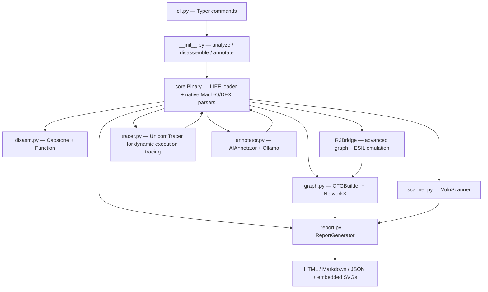

<!-- header:start -->
<div align="center">



<a href="#-quick-start"></a>

<a href="LICENSE"></a>

<a href="https://github.com/ajendras/ReverseKit/stargazers"></a>
<a href="https://github.com/ajendras/ReverseKit/actions/workflows/ci.yml"></a>

<a href="CONTRIBUTING.md"></a>

**All-in-one CLI toolkit for binary disassembly, analysis, visualization and local-AI annotation**

[✨ Features](#-features) • [⚡ Quick start](#-quick-start) • [🧰 Usage](#-usage) • [🧩 Architecture](#-architecture) • [📍 Roadmap](#-roadmap) • [🤝 Contributing](#-contributing)

</div>
<!-- header:end -->

## ✨ Why RevKit?

Reverse engineering workflows are fragmented across Ghidra, radare2, custom scripts and steep learning curves. RevKit unifies the most-used capabilities into a single fast CLI augmented by local LLMs for naming and semantic understanding. Perfect for security researchers, CTF players, firmware analysts and maintainers who need speed without context switching.

- **One-command pipeline** — load, disassemble, annotate and report with `revkit analyze`
- **Local AI only** — function renaming, variable suggestions and comments via Ollama (no cloud, no telemetry)
- **Rich visuals** — CFG graphs, embedded SVGs, interactive HTML reports with zero external dependencies
- **Python first** — import `Binary`, `analyze()`, `CFGBuilder` or `AIAnnotator` for custom automation pipelines

## 🎬 Demo

<p align="center"></p>

## 🚀 Features

<table>
<tr>
<td align="center" valign="top" width="33%">
🔄<br>
<b>Universal Loader</b><br>
Auto-detects and parses ELF, PE, Mach-O, DEX, and raw/flat binaries (including shellcode) using LIEF with dedicated native parsers for Mach-O (segments/load commands) and DEX (classes/methods)
</td>
<td align="center" valign="top" width="33%">
⚡<br>
<b>Capstone Disasm</b><br>
Lightning-fast disassembly for x86, ARM, MIPS, RISC-V and WebAssembly
</td>
<td align="center" valign="top" width="33%">
📈<br>
<b>Advanced CFG</b><br>
Generates control-flow graphs with NetworkX. Uses Radare2 bridge for precise basic-block level graphs and ESIL emulation when available
</td>
</tr>
<tr>
<td align="center" valign="top">
🧠<br>
<b>Local AI Helper</b><br>
Ollama integration renames functions, suggests variable names and adds comments
</td>
<td align="center" valign="top">
🔎<br>
<b>Pattern Scanner</b><br>
Detects common vulnerabilities, anti-debug tricks and library function signatures
</td>
<td align="center" valign="top">
📋<br>
<b>Rich Reports</b><br>
Creates Markdown, JSON and interactive HTML reports with embedded visuals
</td>
</tr>
<tr>
<td align="center" valign="top">
🐍<br>
<b>Python Library</b><br>
Importable API for scripting custom analysis pipelines and automation
</td>
<td align="center" valign="top">
🔤<br>
<b>String Explorer</b><br>
Advanced string extraction, decoding and cross-reference mapping
</td>
<td align="center" valign="top">
🚀<br>
<b>Dynamic Tracing</b><br>
Unicorn-based emulation with per-instruction and register tracing (x86/ARM)
</td>
</tr>
</table>

## 📦 Installation

Requires Python 3.9+, matplotlib (for CFG visualization) and (optionally) an Ollama instance with a code model for AI features. Radare2 + r2pipe are optional for the advanced graph and emulation bridge.

```bash
pip install revkit
```

For AI support:

```bash
ollama pull codellama
ollama serve
```

For Radare2 support:

```bash
pip install r2pipe
# install radare2 from https://rada.re
```

## ⚡ Quick start

```bash
revkit analyze firmware.bin --ai --r2 --report html --output report.html
revkit trace firmware.bin --steps 500 --regs
```

Or via the Python API:

```python
from revkit import analyze, trace

result = analyze(
    "firmware.bin",
    arch="auto",
    ai=True,
    r2=True,
    report="html",
    output="report.html"
)

log = trace("firmware.bin", steps=100, trace_regs=True)
print(f"Traced {len(log)} instructions, first: {log[0]}")
```

## 🧰 Usage

Display binary metadata:

```bash
revkit info sample.elf --arch x86_64
```

Disassemble a function:

```bash
revkit disassemble sample.elf --function main --length 128
```

Generate a control-flow graph:

```bash
revkit visualize sample.elf --function main --output cfg.png --format png --r2
```

Dynamic tracing:

```bash
revkit trace crackme.bin --steps 200 --regs --output trace.json
```

<details>
<summary>AI annotation + report pipeline</summary>

```python
from revkit import annotate, generate_report, CFGBuilder
from revkit.core import Binary

binary = annotate("crackme.bin")                    # runs AIAnnotator.batch_annotate
report = generate_report(binary, fmt="markdown", output="annotated.md")

builder = CFGBuilder(binary)
builder.build_cfg("main")
builder.export_svg("main_cfg.svg")
```
</details>

<details>
<summary>Custom scanner + library usage (CTF example)</summary>

```python
from revkit.core import Binary
from revkit.scanner import VulnScanner
from revkit import disassemble

binary = Binary("ctf_crackme.bin")
scanner = VulnScanner(binary)

print("Anti-debug tricks:", len(scanner.find_anti_debug()))
print("Stack smash candidates:", len(scanner.detect_stack_smash()))

asm = disassemble("ctf_crackme.bin", start=0x401000, length=64)
print(asm)
```
</details>

<details>
<summary>Radare2 bridge usage</summary>

```python
from revkit.core import Binary
from revkit.r2bridge import R2Bridge

binary = Binary("sample.elf")
r2 = R2Bridge(binary)
print("Advanced CFG nodes:", r2.advanced_cfg("main").number_of_nodes())

emu = r2.emulate(binary.entry_point(), steps=20)
print("Emulated PC:", hex(emu.get("registers", {}).get("rip", 0) or 0))
r2.close()
```
</details>

<details>
<summary>Dynamic tracing usage</summary>

```python
from revkit import trace
from revkit.core import Binary

log = trace("shellcode.bin", steps=50, trace_regs=True)
for entry in log[:5]:
    print(entry["address"], entry["instruction"])

binary = Binary("shellcode.bin")
trace_log = binary.trace(steps=100)
print(f"Executed {len(trace_log)} instructions")
```
</details>

## 🔧 Configuration

| Option       | Default   | Description                                      |
|--------------|-----------|--------------------------------------------------|
| `arch`       | `auto`    | Architecture hint passed to Capstone (x86, arm, riscv, auto) |
| `ai`         | `False`   | Enable local Ollama annotation via AIAnnotator |
| `r2`         | `False`   | Enable Radare2 bridge (requires r2pipe and radare2) for advanced features |
| `report`     | `html`    | Report format — one of "html", "markdown", "json" |
| `output`     | `None`    | Path to write report (CLI uses revkit_report.{fmt} by default) |
| `model`      | `codellama` | Ollama model used by AIAnnotator.__init__ |
| `steps`      | `10000`   | Maximum instructions to emulate in dynamic tracing |
| `trace_regs` | `False`   | Log CPU registers on each instruction (Unicorn) |

## 🧩 Architecture



The central `Binary` class (powered by LIEF) is passed between modules. Dedicated `MachOParser` and `DEXParser` classes provide format-specific handling (segments/load commands for Mach-O, classes/methods for DEX). Raw/flat binaries (including empty files and shellcode) are supported as format="RAW". Disassembly, AI annotation and CFG generation are lazily executed only when needed. The public API and CLI both call the same underlying functions, guaranteeing identical results whether used interactively or in scripts. When `r2=True` (or `binary.enable_r2()`), `R2Bridge` augments `CFGBuilder` with radare2's `aaa` + `afbJ` for accurate basic-block CFGs and ESIL emulation. The new `UnicornTracer` (or `binary.trace()`) provides instruction-level dynamic execution tracing with optional register dumps.

## 📁 Project structure

```text
src/revkit/
├── __init__.py          # Public API: Binary, analyze(), disassemble(), annotate(), generate_report()
├── cli.py               # Typer CLI: info, analyze, disassemble, annotate, visualize, report
├── core.py              # Binary class + MachOParser/DEXParser — LIEF parsing, strings(), symbols(), entropy(), read_bytes(), enable_r2()
├── disasm.py            # Capstone wrapper, disassemble_range(), get_function(), Function.to_asm()
├── graph.py             # CFGBuilder — build_cfg(), export_png(), export_svg(), export_dot()
├── r2bridge.py          # R2Bridge for advanced graph (afbJ) and emulation (ESIL)
├── annotator.py         # AIAnnotator — suggest_name(), explain_function(), batch_annotate()
├── scanner.py           # VulnScanner — detect_stack_smash(), find_anti_debug(), match_signatures()
├── report.py            # ReportGenerator — to_html(), to_markdown(), to_json()
├── tracer.py            # UnicornTracer — trace(), instruction + register logging
├── utils.py             # detect_format(), map_arch_to_capstone(), calculate_entropy()
└── __version__          # dynamic via importlib.metadata

tests/
├── conftest.py          # fixtures: sample_elf, mocked_ollama_response, temp_binary
├── test_core.py         # Binary loader, strings, symbols, entropy, R2Bridge integration
└── test_disasm.py       # Capstone accuracy on x86/ARM snippets

examples/
└── ctf_crackme.py       # Full AI annotation → solve-script generation example
```

## 🧪 Testing

```bash
pytest
```

The test suite covers Binary loading (including RAW binaries), string extraction, symbol table parsing, entropy calculation, Capstone disassembly accuracy on known x86/ARM snippets, mocked Ollama responses for annotation tests, R2Bridge integration (with graceful fallback when r2pipe/radare2 is unavailable), and Unicorn tracing (skipped when unicorn is not installed).

## 📍 Roadmap

<!-- roadmap:start -->
- [x] **v0.1.0** — first release: Universal Loader, Capstone Disasm, CFG Builder, Local AI Helper
- [x] Add Mach-O and Android DEX native parsers
- [x] Radare2 bridge for advanced graph and emulation
- [x] Unicorn-based dynamic tracing command
- [ ] Plugin system for third-party analyzers
- [ ] FLIRT signature database downloader and matcher
- [ ] Headless Ghidra integration for decompilation
- [ ] WebAssembly and .NET binary support
- [ ] Parallel processing for large firmware images
- [ ] Interactive terminal explorer (REPL mode)
- [ ] Export to IDA .idb and Binary Ninja .bndb
- [ ] HTML dashboard with zoomable CFGs
- [ ] YARA rule integration for malware family detection

> 🤖 This roadmap is worked through continuously — ideas and PRs welcome!
<!-- roadmap:end -->

## 🤝 Contributing

Contributions are welcome and appreciated! Whether it's a bug fix, new scanner pattern, improved CFG layout or documentation tweak, please read our [CONTRIBUTING.md](https://github.com/ajendras/ReverseKit/blob/main/CONTRIBUTING.md) and adhere to the [CODE_OF_CONDUCT.md](https://github.com/ajendras/ReverseKit/blob/main/CODE_OF_CONDUCT.md). Good-first-issue PRs are especially encouraged — just open a PR against `main`.

## 📄 License

MIT © RevKit Contributors — see [LICENSE](LICENSE) for details.

<!-- footer:start -->
<div align="center">

### ⭐ Star history

<a href="https://star-history.com/#ajendras/ReverseKit&Date"></a>

If **RevKit** saves you time, a ⭐ helps others find it.

Made with ❤️ by [Ajendra](https://ajendra.info)


</div>
<!-- footer:end -->
